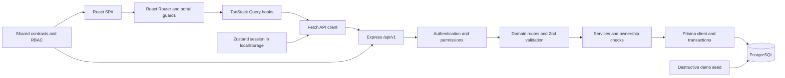
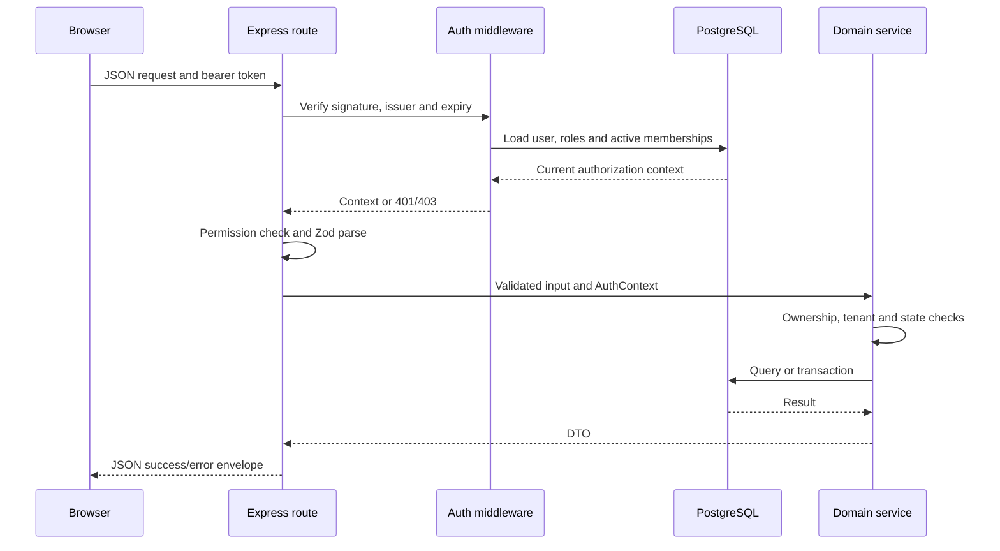
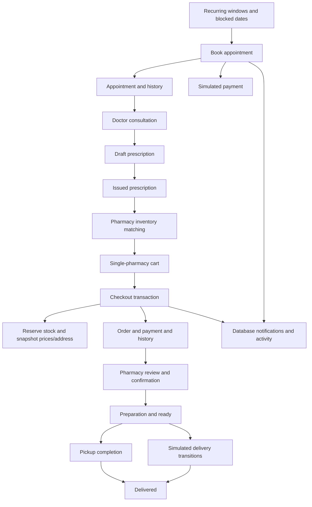

# Architecture

Reviewed: 2026-10-31. These diagrams describe the working tree at `d1e637d`. Infrastructure beyond the local Compose database is **unverified**.

Interactive, source-linked views: [system architecture](../.archify/carebridge-demo-20261031-133500/carebridge-architecture.html), [golden demo workflow](../.archify/carebridge-demo-20261031-133500/golden-demo-workflow.html), [protected request sequence](../.archify/carebridge-demo-20261031-133500/protected-request-sequence.html), and [order lifecycle](../.archify/carebridge-demo-20261031-133500/order-lifecycle.html). For a presentation walkthrough, start with [PRESENTATION_GUIDE](PRESENTATION_GUIDE.md).

## Components

The web application is a client-rendered SPA. Vite provides the development API proxy. Express does not serve the built SPA. Production static hosting, SPA fallback routing, API routing and TLS must be supplied separately.

`apps/api/src/app.ts` installs Helmet, CORS, a 1 MB JSON parser, request logging, versioned routes and error handling. It disables the Express identification header and trusts loopback proxies. `server.ts` closes the HTTP server and disconnects Prisma on termination; there is no forced shutdown deadline.

## Request path

Public catalogs omit authentication; review reads use optional authentication. Supplying several permissions means OR, not AND. Services enforce record-level restrictions; browser guards are presentation controls.

Roles reload from the database on every authenticated request. Effective permissions come from `permissionsForRoles`, not the `RolePermission` database rows. Organization portal membership checks differ from generic tenant helpers, which allow platform bypass. The portal selects a matching membership; global admin privileges are not consistently tied to that membership's staff role (security finding S03).

## Domain flows

### Transactions and limits

- Booking revalidates availability before inserting appointment, payment, history, notifications and activity in a transaction. A migration-only partial unique index prevents equal doctor/start times unless the existing appointment is cancelled. It is not a general interval exclusion constraint.
- Patient overlap checking is a read inside the transaction, without a patient lock. Concurrent same-patient bookings with different doctors are a potential race; runtime reproduction is **unverified**.
- Checkout locks the cart, reads current inventory/pricing, conditionally decrements stock, creates order snapshots/payment and empties the cart in one transaction. Inventory processing is sorted by medicine ID. Subsequent order/delivery mutations lock the order row.
- Cancellation/rejection restores stock and updates simulated payment states. Pharmacy quantity/price reductions revise the simulated payment amount; no external financial ledger or refund exists.
- Consultation is unique per appointment. Doctors manually enter clinical text. Completing consultations and issuing prescriptions use related domain services.
- Notifications and activity are synchronous database writes. No background queue, outbox, push service or email transport was found.

## Browser state and portals

| Area | Implementation |
| --- | --- |
| Remote data | TanStack Query; 30-second default stale time, limited query retries, no mutation retries |
| Authentication | Persisted Zustand token/user; fetch attaches bearer token |
| Explicit logout | Clears auth and query cache |
| Unauthorized response | Clears auth; does not itself clear query cache |
| Notification badge | Polls unread count each minute |
| Forms/filters | React state, selected React Hook Form/Zod use and URL params |
| Public/patient | Catalog, bookings, prescriptions, cart/orders, records, profiles |
| Doctor | Appointments, consultations, prescriptions, patients, availability, profile |
| Organization | Clinic/hospital staff, doctors, services, schedules, patients, reports |
| Pharmacy | Order list/detail and processing |
| Platform | Entity management, approvals, employees, settings, activity and reports |

`router.tsx` still imports most route pages eagerly, but organization dashboard/reports and admin dashboard/reports use route-level lazy imports. Shared contracts are maintained manually; no OpenAPI-generated client exists.

## Persistence and operational boundary

Prisma owns persistence. Money uses PostgreSQL decimal columns but DTOs commonly convert amounts to JavaScript numbers. Date-only fields coexist with timestamp fields; scheduling utilities explicitly handle IST. Orders snapshot addresses; lab bookings reference mutable address rows.

The seed truncates application tables in the selected schema, preserving the Prisma migrations table, then inserts fixtures. The HTTP reset has a permission/development gate; CLI seed has no equivalent production guard. API/Playwright setup migrates and reseeds a separately configured test database. These tools require disposable targets.

Sources: [app](../apps/api/src/app.ts), [API routes](../apps/api/src/routes/index.ts), [auth](../apps/api/src/middleware/auth.ts), [services](../apps/api/src/services), [orders](../apps/api/src/modules/orders/orders.service.ts), [appointments](../apps/api/src/modules/appointments/appointments.service.ts), [browser router](../apps/web/src/routes/router.tsx), [query client](../apps/web/src/api/query-client.ts).
